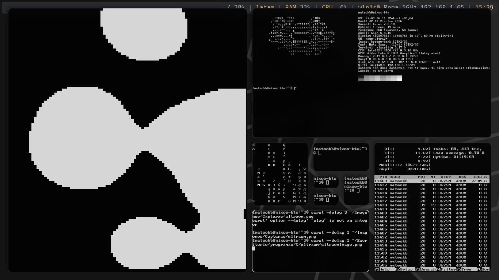

# UltraWM 
## simple, efficient and powerful window manager 

UltraWM is a window manager for X11 written in C in just 1200 lines of code 

Features:

* 5 Different layouts (master, superior master, dwindle, fibonacci and scroll)

* Easy lua configuration file
 
* Low resource usage
* 10 workspaces

## Installation
### Arch
* coming soon

### NixOS
* coming soon

### Source
1. git clone https://github.com/T3S3R4CT0/UltraWM.git
2. cd ultrawm
3. ./build.sh

#Keybinds
* Super + enter = spawn terminal
* Super + q = kill window
* Super + j = previous window
* Super + k = next window
* Super + 1 = go to workspace 1
* Super + 2 = go to workspace 2
* Super + 3 = go to workspace 3
* Super + 4 = go to workspace 4
* Super + 5 = go to workspace 5
* Super + 6 = go to workspace 6
* Super + 7 = go to workspace 7
* Super + 8 = go to workspace 8
* Super + 9 = go to workspace 9
* Super + 0 = go to workspace 0
* Alt + 1 = set master layout
* Alt + 2 = set superior master layout
* Alt + 3 = set dwindle layout
* Alt + 4 = set fibonacci layout
* Alt + 5 = set scroll layout
* Super + r = reload configuration
* Super + space = spawn launcher
* Super + e = exit session
* Super + f11 = toggle fullscreen

# NOTE:
## UltraWM is in an early development stage, it may lack some features and have some bugs. If you find a bug, have a issue or a useful feature in mind, please tell me

